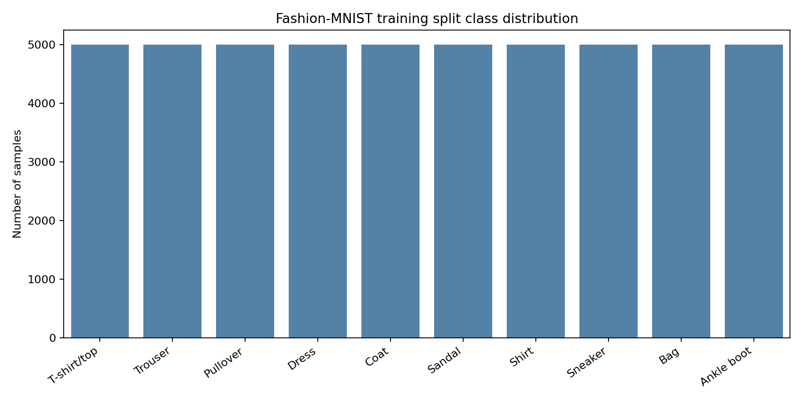
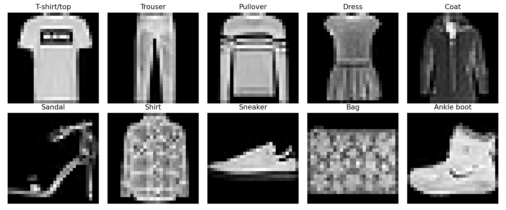
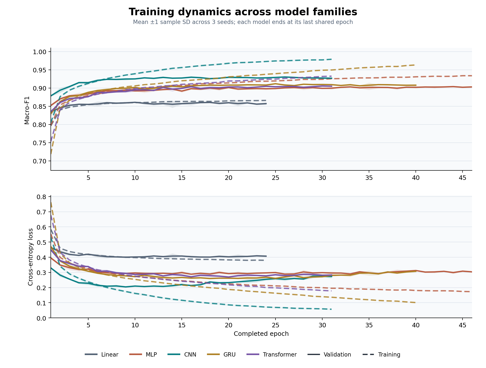
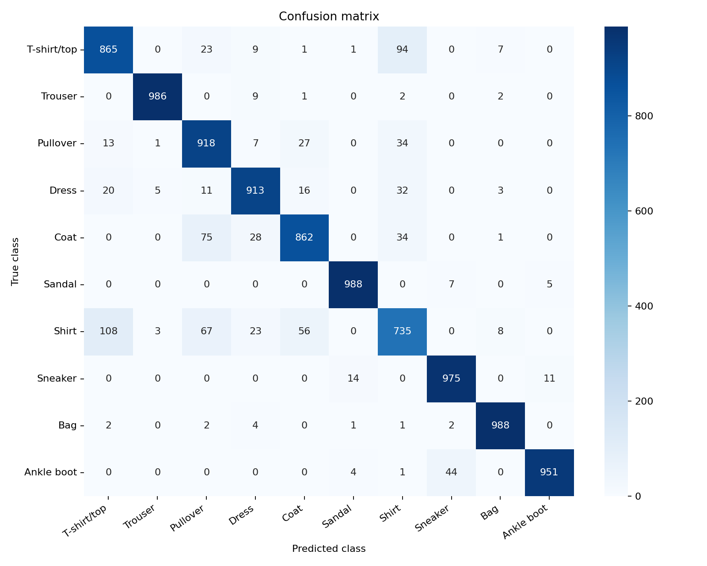
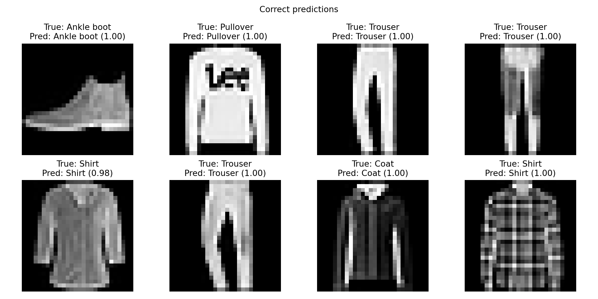
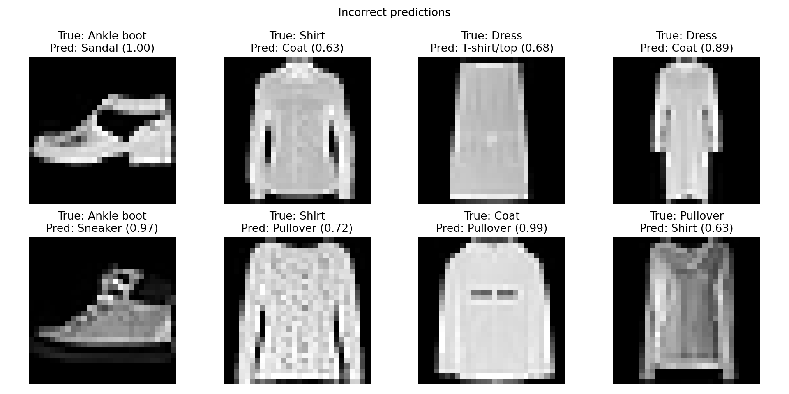

# Assignment 1

## Foundations of Deep Learning Pipelines and Architectures

**Nguyen Minh Quang · 2453052**

> A controlled comparison of five classifier families on Fashion-MNIST,
> from a linear baseline to spatial and row-token architectures.

[Download the report](../assignment1/report/DL_A1_report.pdf) · [Watch the presentation](https://youtu.be/nHcVq0U0Zc4)

## At a glance

| Dataset | Input | Classes | Models |
|---|---|---:|---|
| Fashion-MNIST | grayscale 28 × 28 | 10 | Linear · MLP · CNN · GRU · Transformer |

| Split | Training | Validation | Official test |
|---|---|---:|---:|
| Samples | 50,000 | 10,000 | 10,000 |

## Page map

- [1. Problem and data](#1-problem-and-data)
- [2. Methodology](#2-methodology)
- [3. Implementation results](#3-implementation-results)
- [4. Reproducibility and contribution](#4-reproducibility-and-contribution)

---

## 1. Problem and data

### 1.1 Problem formulation

The experiment compares how different representation choices affect
Fashion-MNIST image classification under one shared split, preprocessing
protocol, training procedure, and evaluation procedure.

- **Linear and MLP:** flatten the image into 784 pixel values.
- **CNN:** preserve the two-dimensional image layout and reuse local filters.
- **GRU and Transformer:** process the 28 image rows as an ordered sequence.
- **Primary metrics:** test accuracy and macro-F1.
- **Additional context:** trainable parameter count and measured inference cost.

### 1.2 Dataset and preprocessing

Fashion-MNIST contains 70,000 labeled grayscale images across ten clothing
classes. Every sample is a single 28 × 28 image. The official training
partition was split into 50,000 training and 10,000 validation samples using
stratification and split seed 42. The official 10,000-image test set remained
separate for final evaluation.

The main runs use ToTensor followed by normalization with mean 0.286276 and
population standard deviation 0.353185, computed from the training subset.
The input shape is [1, 28, 28], and the batch size is 128.

---

## 2. Methodology

### 2.1 Shared pipeline

~~~text
Fashion-MNIST
    → saved stratified split
    → tensor conversion and normalization
    → model forward pass
    → cross-entropy on logits
    → Adam update
    → validation after each epoch
    → best checkpoint by validation macro-F1
    → one final test evaluation
~~~

All five models use the same data module, training loop, checkpoint rule,
evaluation code, and training seeds 42, 123, and 2026. The selected checkpoint
is the one with the best validation macro-F1; the test set is used once for the
final model evaluation.

### 2.2 Model families

| Model | Representation | Main architecture | Parameters |
|---|---|---|---:|
| Linear | Flattened pixels | 784 → 10 | 7,850 |
| MLP | Flattened pixels | 784 → 256 → 128 → 10, ReLU, dropout 0.2 | 235,146 |
| CNN | Spatial image | convolution/pooling blocks, 3136 → 128 → 10, dropout 0.3 | 421,642 |
| GRU | 28 image rows | one-layer GRU, hidden size 128 | 61,962 |
| Transformer | 28 image rows | two-layer Transformer encoder | 71,242 |

### 2.3 Common training and evaluation protocol

| Setting | Value |
|---|---|
| Loss | Cross-entropy on raw logits |
| Optimizer | Adam |
| Learning rate | 0.001 |
| Weight decay | 0.0001 |
| Maximum epochs | 100 |
| Early stopping | Validation macro-F1, patience 15, min_delta = 0.0001 |
| Precision | Float32 |
| Hardware | NVIDIA GeForce RTX 4050 Laptop GPU |
| Environment | Python 3.11.15 · PyTorch 2.5.1+cu121 · torchvision 0.20.1+cu121 |

Inference timing uses warm-up batches, repeated full-loader passes, and CUDA
synchronization. It describes the implementation and hardware environment.

### 2.4 Architecture notes

- **Linear:** a small reference model with one affine decision boundary per class.
- **MLP:** learns nonlinear feature combinations from flattened pixels.
- **CNN:** preserves local neighborhoods through convolution and pooling.
- **GRU:** scans horizontal image rows from top to bottom with a recurrent state.
- **Transformer:** compares row tokens with self-attention and positional information.

---

## 3. Implementation results

### 3.1 Training behavior

The combined curves show the training and validation behavior across the five
models. The CNN reaches the strongest validation macro-F1 and maintains the
best final predictive performance. The Linear model converges quickly to a
lower plateau, while the sequence models improve through their recurrent or
attention-based row representations.

### 3.2 Quantitative results

The table reports the mean and sample standard deviation across three training
seeds. Accuracy and macro-F1 are the primary comparison metrics.

| Model | Accuracy | Macro-F1 | Parameters | Inference (ms/sample) |
|---|---:|---:|---:|---:|
| Linear | 84.31 ± 0.09% | 84.23 ± 0.06% | 7,850 | 0.00530 ± 0.00350 |
| MLP | 89.37 ± 0.11% | 89.31 ± 0.12% | 235,146 | 0.00781 ± 0.00833 |
| CNN | **92.22 ± 0.39%** | **92.20 ± 0.41%** | 421,642 | 0.01265 ± 0.01304 |
| GRU | 90.29 ± 0.19% | 90.26 ± 0.21% | 61,962 | 0.01880 ± 0.00734 |
| Transformer | 89.40 ± 0.09% | 89.37 ± 0.13% | 71,242 | 0.05044 ± 0.03408 |

The CNN is the strongest model on both primary metrics. The MLP improves over
the Linear baseline through nonlinear feature composition, while the CNN gains
further from spatially shared filters. The GRU is the second strongest model
with fewer parameters than the CNN. The Transformer remains close to the MLP
but does not provide a predictive advantage in this row-token configuration.

### 3.3 Qualitative results

The CNN is selected for qualitative analysis because it has the highest mean
accuracy and macro-F1.

### 3.4 Error analysis

The main difficulty is distinguishing visually similar upper-body classes.
For the CNN seed-42 checkpoint, Shirt has the lowest recall at 73.5%, while
Trouser, Sandal, and Bag reach 98.6%, 98.8%, and 98.8%, respectively. The six
largest confusion pairs are:

| True class → predicted class | Errors | Rate |
|---|---:|---:|
| Shirt → T-shirt/top | 108 | 10.8% |
| T-shirt/top → Shirt | 94 | 9.4% |
| Coat → Pullover | 75 | 7.5% |
| Shirt → Pullover | 67 | 6.7% |
| Shirt → Coat | 56 | 5.6% |
| Ankle boot → Sneaker | 44 | 4.4% |

Among the 819 CNN errors in this seed, 532, approximately 65.0%, involve
T-shirt/top, Pullover, Coat, or Shirt. This concentration explains why macro-F1
is reported together with accuracy: a strong aggregate score can still hide a
weak class.

### 3.5 Representation ablation

The ablation changes only the image-to-sequence representation for GRU and
Transformer. Rows and columns use 28 tokens; patches use 49 4 × 4 tokens.
The seed-42 best validation accuracies are:

| Model | Rows | Columns | 4 × 4 patches |
|---|---:|---:|---:|
| GRU | **91.19%** | 90.31% | 89.67% |
| Transformer | **90.63%** | 90.29% | 89.93% |

The row representation is the strongest among the tested variants for both
sequence models. This is evidence for the selected configurations on this
dataset and seed; repeating the ablation with all three seeds would be needed
for a more stable estimate.

### 3.6 Limitations

The conclusions are specific to small, centered, grayscale Fashion-MNIST
images. The five models also differ in representation, parameter count, and
architecture-specific regularization, so the ranking does not isolate one
architectural component. Inference measurements describe this implementation
and hardware environment.

---

## 4. Reproducibility and contribution

The source code, model configurations, split manifest, and saved benchmark
artifacts are available in the repository. The report source is kept locally;
the submitted repository includes the exported report PDF and presentation
materials.

Nguyen Minh Quang (2453052) is responsible for the complete Assignment 1:
EDA, preprocessing, DataLoader preparation, implementation of all five models,
experiment execution, result aggregation, comparison and error analysis,
report, slides, and video presentation.

AI assistance was used for planning, implementation support, result checking,
analysis, and report organization. The AI usage table and verification details
are recorded in [AI_USAGE.md](../AI_USAGE.md).
