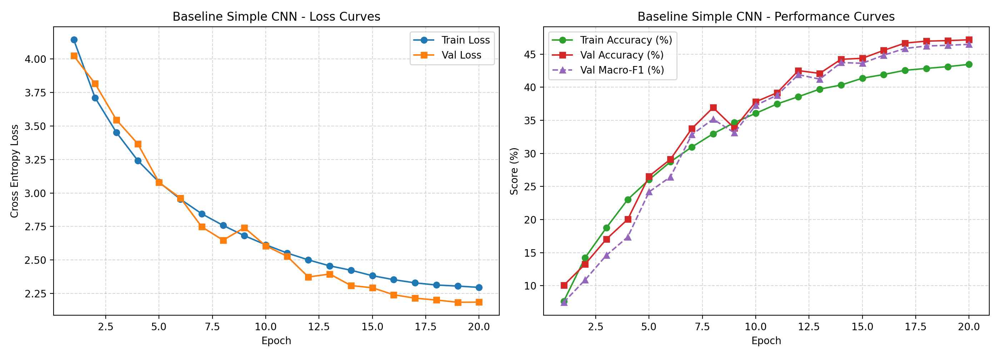

# Assignment 2 — Deep Learning on Large-Scale Data and Specialized Tasks
### Task track: Image Classification (Food-101)

**Status:** In Progress — M2 Draft milestone (Baseline completed, Pretrained models in progress).

**Group 99 - PTQ members:**
- Nguyen Minh Phuc (2453005)
- Nguyen Thanh The (2453191)
- Nguyen Minh Quang (2453052)
**Instructor:** Lê Thành Sách

---

## 1. Problem Statement
The objective of Assignment 2 is to tackle large-scale visual recognition on the **Food-101** benchmark. Food recognition is notoriously difficult due to extreme intra-class variation, subtle inter-class differences (e.g., distinguishing between different types of steaks, noodles, or cakes), non-rigid object shapes, and real-world label noise in the training set.

The system takes an RGB food image as input and predicts one of 101 food categories.

---

## 2. Dataset Description & EDA
- **Dataset:** Food-101 (ETH Zürich Computer Vision Lab)
- **Total Images:** 101,000 RGB images across 101 classes (balanced: 750 train, 250 test per class)
- **Official Split:** 75,750 training images, 25,250 test images
- **Experimental Split:**
  - **Training:** 68,175 images (90% of official train)
  - **Validation:** 7,575 images (10% stratified split, seed 42)
  - **Test:** 25,250 images (strictly reserved for final evaluation)
- **Dataset Proposal:** Full proposal with 11 mandatory sections is submitted at [`assignment2/proposal/dataset_proposal.md`](https://github.com/tapstoptap/deep-learning-261/blob/feat/assignment2-food101/assignment2/proposal/dataset_proposal.md).

---

## 3. Methodology

### 3.1 Pipeline Overview
```text
Raw Image (RGB) 
  → Resize (224×224) & Augmentation (Random Horizontal Flip) 
  → Normalization (ImageNet mean & std) 
  → DataLoader (batch size 64) 
  → Model 
  → Cross-Entropy Loss 
  → AdamW Optimizer + Cosine Scheduler 
  → Evaluation (Accuracy, Macro-F1)
```

### 3.2 Architectures
1. **E1 — Simple CNN Baseline (from scratch):**
   - 4 Convolutional blocks: `Conv2d(3, 32)` $\rightarrow$ `Conv2d(32, 64)` $\rightarrow$ `Conv2d(64, 128)` $\rightarrow$ `Conv2d(128, 256)`, each followed by `BatchNorm2d`, `ReLU`, and `MaxPool2d(2)`.
   - `AdaptiveAvgPool2d((1, 1))` Global Average Pooling.
   - Classification head: `Dropout(0.3)` $\rightarrow$ `Linear(256, 101)`.
   - Total trainable parameters: **414,853**.

2. **E2 — ResNet-50 Feature Extractor (Frozen Backbone):**
   - ImageNet-pretrained ResNet-50 backbone frozen.
   - Only the final classification head (`Linear(2048, 101)`) is trained.

3. **E3 — ResNet-50 Fine-Tuning (Full fine-tuning):**
   - ImageNet-pretrained ResNet-50 with all layers unfrozen and trained end-to-end at a lower learning rate ($10^{-4}$).

---

## 4. Experimental Setup
- **Hardware:** NVIDIA Tesla T4 GPU (Google Colab, 16 GB VRAM)
- **Batch Size:** 64
- **Epochs:** 20 (Baseline)
- **Optimizer:** AdamW ($\text{lr} = 10^{-3}$, $\text{weight decay} = 10^{-4}$)
- **LR Scheduler:** CosineAnnealingLR
- **Evaluation Metrics:** Top-1 Accuracy and Macro-F1.

---

## 5. Preliminary Results (Milestone M2 Draft)

### 5.1 Quantitative Results
| Experiment | Model | Backbone | Trainable Params | Epochs | Training Time | Train Acc | Val Acc | Val Macro-F1 | Test Acc | Test Macro-F1 |
|---|---|---|---:|---:|---:|---:|---:|---:|---:|---:|
| **E1** | Simple CNN | Scratch (4-block CNN) | 414,853 | 20 | 172.99 min | 43.45% | **47.17%** | **46.48%** | TBD | TBD |
| **E2** | ResNet-50 | Pretrained (Frozen) | ~206,949 | 15 | In progress | — | — | — | — | — |
| **E3** | ResNet-50 | Pretrained (Fine-tune) | ~23.7M | 15 | Pending | — | — | — | — | — |

### 5.2 Baseline Training Curves


- **Training observation:** The baseline Simple CNN trained stably over 20 epochs without divergence. Both validation accuracy (47.17%) and validation macro-F1 (46.48%) improved steadily. 
- Validation loss closely tracked training loss until around epoch 12 where the validation loss flattened out at ~2.18, indicating the capacity limit of the lightweight 4-layer network on this 101-class problem.

---

## 6. Comparison and Discussion
*(To be expanded upon completion of E2 and E3)*
- The baseline Simple CNN demonstrates reasonable discriminative ability (47.17% Val Acc) considering it was trained from scratch with only 414K parameters on 101 complex fine-grained classes.
- We hypothesize that transferring rich feature representations from ImageNet via ResNet-50 (E2 and E3) will substantially boost accuracy (>75%) by leveraging hierarchical visual features learned on 1.28 million natural images.

---

## 7. Compute-Cost Analysis
| Model | Hardware | Epochs | Total Training Time | Avg. Time per Epoch |
|---|---|---:|---:|---:|
| Simple CNN (Baseline) | Tesla T4 GPU | 20 | 172.99 min (~2.88 hrs) | ~518 s (8.6 min) |
| ResNet-50 Frozen (E2) | Tesla T4 GPU | 15 | In progress | Expected ~3-4 min |
| ResNet-50 Fine-tuned (E3) | Tesla T4 GPU | 15 | Pending | Expected ~8-10 min |

---

## 8. Links
- Dataset proposal: [`assignment2/proposal/dataset_proposal.md`](https://github.com/tapstoptap/deep-learning-261/blob/feat/assignment2-food101/assignment2/proposal/dataset_proposal.md)
- Source code: [GitHub Repository](https://github.com/tapstoptap/deep-learning-261/tree/feat/assignment2-food101/assignment2)
- Colab Runner Notebook: [`colab_runner.ipynb`](https://github.com/tapstoptap/deep-learning-261/blob/feat/assignment2-food101/assignment2/colab_runner.ipynb)

---

## AI Usage Disclosure (Assignment 2)
See [AI_USAGE.md](../AI_USAGE.md) for the full log. Generative AI was used to assist with model architecture design, training/evaluation pipeline implementation, config generation, and log parsing. All experiment runs were executed and verified on Google Colab.
