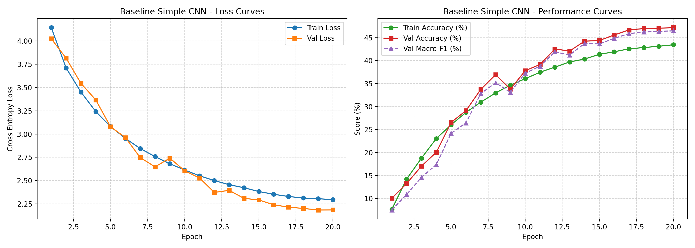
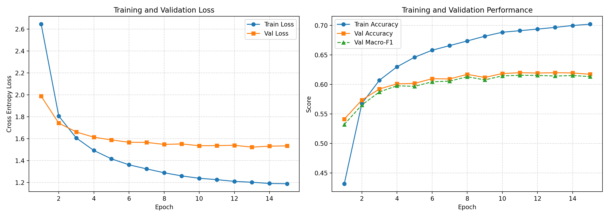
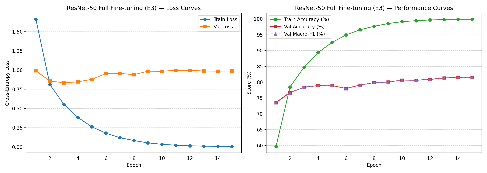
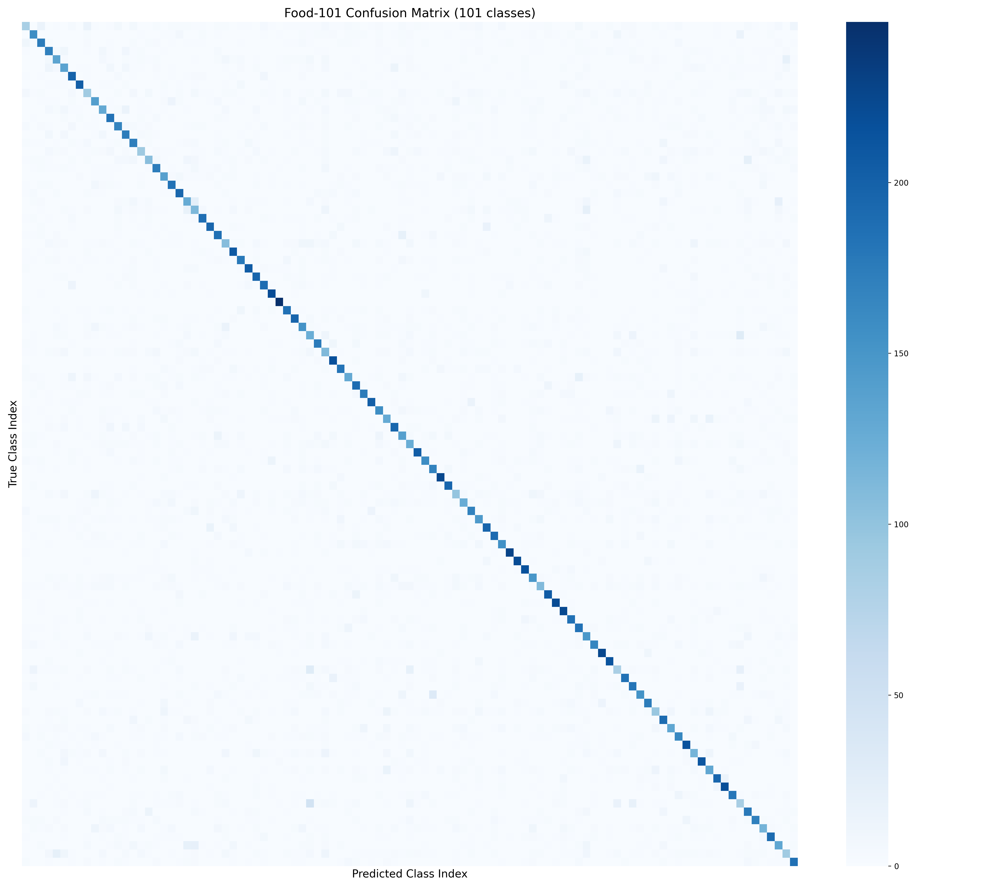

# Assignment 2 — Deep Learning on Large-Scale Data and Specialized Tasks
### Task track: Image Classification (Food-101)

**Status:** Completed (four runs evaluated on the official test set, including the matched frozen-vs-unfrozen control; M3-Final report).

**Group 99 - PTQ members:**
- Nguyen Minh Phuc (2453005)
- Nguyen Thanh The (2453191)
- Nguyen Minh Quang (2453052)
**Instructor:** Lê Thành Sách

<div style="max-width: 900px; margin: 1rem 0 2rem;">
<iframe width="100%" height="500" src="https://www.youtube.com/embed/xfPd0ZnpQYE" title="Assignment 2 presentation" frameborder="0" allow="accelerometer; autoplay; clipboard-write; encrypted-media; gyroscope; picture-in-picture; web-share" allowfullscreen></iframe>
</div>

---

## 1. Problem Statement
The objective of Assignment 2 is to tackle large-scale fine-grained visual recognition on the **Food-101** benchmark. Food recognition presents unique challenges in computer vision:
- **High intra-class variability:** The visual appearance of a dish varies wildly with preparation methods, chef presentation, lighting, slicing style, and side garnishes.
- **Subtle inter-class boundaries:** Many categories share nearly identical visual textures, colors, and geometries (e.g., distinguishing *steak* from *filet mignon*, *tuna tartare* from *beef tartare*, or *ramen* from *pho*).
- **Non-rigid object deformations:** Unlike rigid objects (vehicles, furniture), food items have amorphous geometries and deformable boundaries.
- **Real-world noise:** Per the dataset creators, training images intentionally contain real-world label noise and casual photography artifacts.

The goal is to map an RGB food image to one of 101 target food categories using PyTorch, comparing from-scratch architectures against modern transfer learning and fine-tuning protocols.

---

## 2. Dataset Description & Exploratory Data Analysis (EDA)

### 2.1 Dataset Overview & Partitioning
- **Dataset:** Food-101 (ETH Zürich Computer Vision Lab; Bossard et al., ECCV 2014).
- **Volume:** 101,000 RGB images across 101 classes.
- **License and use:** the images originate from Foodspotting and are used for academic coursework only. Image files are not redistributed in this repository.
- **Format:** JPEG; the original images have a maximum side of 512 px and are resized to $224 \times 224$ for training and evaluation.
- **Class balance:** the official split has 750 training and 250 test images per class; the project split therefore has 675/75/250 images per class.
- **Split Protocol (No Data Leakage):**
  - **Training:** 68,175 images (90% of official training split, exactly 675 images/class).
  - **Validation:** 7,575 images (10% stratified hold-out, exactly 75 images/class, seed 42).
  - **Test:** 25,250 images (strictly isolated official test set, exactly 250 images/class).


### 2.2 Taxonomic Composition
For analysis only, the 101 food classes are grouped into eight culinary domains. This is **not** an official Food-101 taxonomy; every class is assigned exactly once, and the counts sum to 101.

1. **Desserts & Pastries (22 classes):** e.g., *apple pie, cannoli, chocolate mousse, macarons, tiramisu*.
2. **Meat & Poultry (13 classes):** e.g., *baby back ribs, beef carpaccio, filet mignon, peking duck, steak*.
3. **Asian & Regional Specialties (15 classes):** e.g., *bibimbap, dumplings, gyoza, pad thai, pho, ramen, sushi*.
4. **Fast Food & Sandwiches (17 classes):** e.g., *club sandwich, hamburger, hot dog, pizza, tacos, poutine*.
5. **Seafood (12 classes):** e.g., *clam chowder, grilled salmon, mussels, oysters, tuna tartare*.
6. **Pasta, Noodles & Rice (8 classes):** e.g., *lasagna, macaroni and cheese, risotto, spaghetti carbonara, paella*.
7. **Salads, Vegetables & Starters (10 classes):** e.g., *caesar salad, greek salad, guacamole, hummus, deviled eggs*.
8. **Breakfast & Egg Dishes (4 classes):** e.g., *eggs benedict, huevos rancheros, omelette, french toast*.

### 2.3 Class Difficulty Analysis


This section is a post-hoc analysis of E2 test predictions, not a survey of the training images, and it was not used for tuning.
- **Most Distinctive Classes (>85% recall):** Items with distinctive geometric forms, singular colors, or packaging (e.g., *edamame* pods, layered *macarons*, *oysters* in shells, *miso soup* bowls).
- **Most Challenging Classes (<55% recall in feature extractor):** Foods characterized by continuous textures, sauces, or ambiguous culinary cuts (e.g., *foie gras, steak, pork chop, apple pie, bread pudding*).

---

## 3. Methodology

### 3.1 Pipeline Overview
```text
Raw Image (RGB) 
  → Preprocessing: Resize(224×224) 
  → Augmentation: RandomHorizontalFlip(p=0.5) 
  → Normalization: ImageNet mean [0.485, 0.456, 0.406], std [0.229, 0.224, 0.225]
  → PyTorch DataLoader (batch size 32 / 64)
  → Deep Architecture (E1 / E2 / E3)
  → Cross-Entropy Loss
  → Optimizer (Adam / AdamW; cosine annealing for E2/E3/A0, constant LR for E1)
  → Prediction (Argmax) & Metric Computation (Accuracy, Macro-F1, Confusion Matrix)
```

An example training batch is a `float32` tensor of shape `[B, 3, 224, 224]`, where `B=64` for E1/E2 and `B=32` for E3. Training uses only random horizontal flipping; validation and test use resize and normalization with no augmentation.

### 3.2 Model Architectures & Comparison Design
We compare three adaptation regimes plus a matched frozen control (A0) under a shared data split and evaluation protocol. They are a **protocol comparison**, not three one-factor ablations: E1 vs E2 changes architecture and initialization, while E2 vs E3 changes unfreezing *and* the optimization protocol (Adam vs AdamW, learning rate, batch size, and GPU). Fixed factors are the train/validation/test split, input size, seed 42, weight decay, checkpoint rule, and metric set (E2/E3/A0 also share a configured cosine schedule; E1 trains at a constant rate). The combined E2→E3 gap is therefore descriptive, not a clean causal estimate of unfreezing alone. A fourth run, **A0**, resolves this: it keeps the E2 frozen backbone but trains it with the E3 protocol (AdamW, $10^{-4}$, batch 32, 15 epochs), so A0 and E3 share the optimisation protocol and differ in `freeze_backbone` (A0 also ran on an unlogged Colab GPU, so hardware is not matched).

1. **E1 — Baseline Simple CNN (Trained from scratch):**
   - 4 Convolutional blocks: `Conv2d(3, 32)` $\rightarrow$ `Conv2d(32, 64)` $\rightarrow$ `Conv2d(64, 128)` $\rightarrow$ `Conv2d(128, 256)`. Each block features `BatchNorm2d`, `ReLU`, and `MaxPool2d(2)`.
   - Global representation: `AdaptiveAvgPool2d((1, 1))`.
   - Classification head: `Dropout(0.3)` $\rightarrow$ `Linear(256, 101)`.
   - Total parameters: **414,853** (all trainable).

2. **E2 — ResNet-50 Feature Extractor (Frozen Backbone):**
   - Backbone: ResNet-50 pretrained on ImageNet-1k (50 layers, deep residual bottlenecks).
   - Backbone parameters: 23,508,032 (strictly **frozen**, `requires_grad = False`). Only parameters are frozen: the model still runs in training mode, so the backbone BatchNorm running statistics keep updating from Food-101 batches while their affine weights stay fixed.
   - Classification head: `Dropout(0.2)` $\rightarrow$ `Linear(2048, 101)`.
   - Trainable parameters: **206,949** (only 0.87% of total network parameters).

3. **E3 — ResNet-50 Full Fine-Tuning (End-to-End Adaptation):**
   - Backbone: ResNet-50 initialized from ImageNet-1k weights.
   - All 23,714,981 parameters are **unfrozen** and fine-tuned end-to-end at a calibrated learning rate ($\eta = 10^{-4}$) with AdamW; the config specifies cosine annealing, confirmed by the exported Kaggle run, while the saved history logs a constant rate (a curation artifact; see Limitations).

4. **A0 — Matched-control Frozen ResNet-50:**
   - Same frozen backbone and head as E2 (206,949 trainable parameters).
   - Trained with the E3 protocol: AdamW, $10^{-4}$, batch 32, cosine schedule, 15 epochs, seed 42.
   - The only intended experimental difference from E3 is `freeze_backbone`; hardware also differs (A0 ran on an unlogged Colab GPU, E3 on a P100). The difference from E2 is the optimizer, learning rate, batch size, and GPU.

---

## 4. Experimental Setup

| Parameter | E1 (Baseline CNN) | E2 (ResNet-50 Frozen) | A0 (Frozen, E3 protocol) | E3 (ResNet-50 Fine-tuned) |
|---|:---:|:---:|:---:|:---:|
| **Hardware** | Tesla T4 GPU (Kaggle) | Tesla T4 GPU (Kaggle) | Colab GPU (model not logged) | Tesla P100 GPU (Kaggle) |
| **Input Resolution** | $224 \times 224 \times 3$ | $224 \times 224 \times 3$ | $224 \times 224 \times 3$ | $224 \times 224 \times 3$ |
| **Batch Size** | 64 | 64 | 32 | 32 |
| **Epochs** | 20 | 15 | 15 | 15 |
| **Optimizer** | AdamW ($\beta_1=0.9, \beta_2=0.999$) | Adam | AdamW | AdamW |
| **Initial Learning Rate** | $1 \times 10^{-3}$ | $1 \times 10^{-3}$ | $1 \times 10^{-4}$ | $1 \times 10^{-4}$ |
| **Weight Decay** | $1 \times 10^{-4}$ | $1 \times 10^{-4}$ | $1 \times 10^{-4}$ | $1 \times 10^{-4}$ |
| **LR Scheduler** | None (constant) | CosineAnnealingLR | CosineAnnealingLR | CosineAnnealingLR |
| **Seed** | 42 | 42 | 42 | 42 |
| **Checkpoint rule** | Best validation macro-F1 | Best validation macro-F1 | Best validation macro-F1 | Best validation macro-F1 |
| **Framework** | PyTorch 2.x + torchvision (Kaggle image) | PyTorch 2.x + torchvision (Kaggle image) | PyTorch 2.x + torchvision (Colab image) | PyTorch 2.x + torchvision (Kaggle image) |
| **Evaluation** | Official test, 25,250 images | Official test, 25,250 images | Official test, 25,250 images | Official test, 25,250 images |

The instrumented Kaggle session that produced the inference benchmark and the qualitative grid reported `torch 2.11.0+cu128`, `torchvision 0.26.0+cu128`, CUDA 12.8, cuDNN 91900, Python 3.13.15, and a Tesla T4. The builds used when E1–E3 were trained were not logged and remain a known gap. The analysis/plot environment used for this repository is Python 3.12.5 with PyTorch 2.5.1+cpu and torchvision 0.20.1+cpu.

| Run | Hypothesis | Changed factor(s) | Fixed factors | Decision rule |
|---|---|---|---|---|
| E1 | A scratch CNN provides a lower-bound reference. | Architecture and random initialization. | Data split, input size, seed, weight decay, metric set. | Report accuracy and macro-F1; no superiority claim. |
| E2 | Frozen ImageNet features improve over the scratch reference. | Architecture and pretrained initialization. | Data split, input size, seed, weight decay, metric set. | Higher test accuracy and macro-F1 than E1; report parameter count. |
| E3 | Full fine-tuning improves over the frozen backbone. | Unfreezing, optimizer, learning rate, batch size, GPU. | Data split, input size, seed, weight decay, metric set, epoch count (15). | Higher test accuracy and macro-F1 than E2, with the protocol confound stated. |
| A0 | The E2→E3 gap is not an artefact of the protocol switch. | Vs. E2: optimizer, learning rate, batch size, GPU. | Data split, input size, seed, weight decay, metric set, epoch count (15), frozen backbone. | Frozen baseline under the E3 protocol; in the two recorded runs E3 exceeds A0 by 24.46 accuracy points (A0 ran on an unlogged Colab GPU, so the gap is descriptive). |

---

## 5. Experimental Results

### 5.1 Comprehensive Benchmark Table (Official Test Set: 25,250 Images)
All models were evaluated on the completely unseen, official 25,250-image test set:

| Exp | Model Architecture | Adaptation Mode | Trainable Params | Training Time | Train Acc | Val Acc | Val Macro-F1 | Test Loss | **Test Accuracy** | **Test Macro-F1** |
|:---:|---|---|---:|---:|---:|---:|---:|---:|:---:|:---:|
| **E1** | Simple CNN | Scratch (Random Init) | 414,853 | 162.52 min | 43.64% | 47.17% | 46.38% | 1.9649 | **51.96%** | **51.21%** |
| **E2** | ResNet-50 | Pretrained (Frozen) | **206,949** | **149.82 min** | 70.21% | 61.98% | 61.55% | 1.2933 | **66.70%** | **66.36%** |
| **A0** | ResNet-50 | Frozen, E3 protocol | 206,949 | 108.17 min | 58.7% | 57.5% | 56.61% | 1.6553 | **61.71%** | **60.88%** |
| **E3** | ResNet-50 | Pretrained (Fine-tune) | 23,714,981 | 269.35 min | 99.88% | **81.50%** | **81.45%** | **0.6494** | **86.17%** | **86.10%** |

Training time is wall-clock time on the listed GPU. E1/E2 ran on a Tesla T4, E3 on a Tesla P100, and A0 on an unlogged Colab GPU, so the durations are not hardware-matched. Train Acc is the final-epoch training accuracy; Val Acc / Val Macro-F1 are at the selected checkpoint (best validation macro-F1). For E2 these are different epochs: final-epoch train accuracy is 70.21%, while the selected epoch 11 gives 61.98% validation accuracy and 61.55% macro-F1. For E3 the validation accuracy peak is 81.50% at epoch 14, while the selected epoch 15 gives 81.49% / 81.45%. A0 train/validation values are read from its training curves.

### 5.2 Training and Validation Trajectories

#### Baseline Simple CNN (E1)


#### ResNet-50 Frozen Backbone (E2)


#### ResNet-50 Full Fine-tuning (E3)


#### Matched Control A0 (frozen backbone, E3 protocol)


---

## 6. Comparison and Discussion

| Dimension | E1: Baseline CNN | E2: ResNet-50 Frozen | A0: Frozen, E3 protocol | E3: ResNet-50 Fine-tuned | $\Delta$ (E2 vs E1) | $\Delta$ (E3 vs E2) | $\Delta$ (E3 vs A0) | $\Delta$ (E3 vs E1) |
|---|:---:|:---:|:---:|:---:|:---:|:---:|:---:|:---:|
| **Test Accuracy** | 51.96% | 66.70% | 61.71% | **86.17%** | **+14.74 pp** | **+19.47 pp** | **+24.46 pp** | **+34.21 pp** |
| **Test Macro-F1** | 51.21% | 66.36% | 60.88% | **86.10%** | **+15.15 pp** | **+19.74 pp** | **+25.22 pp** | **+34.89 pp** |
| **Test Loss** | 1.9649 | 1.2933 | 1.6553 | **0.6494** | -0.6716 | -0.6439 | -1.0058 | -1.3155 |
| **Trainable Params** | 414,853 | **206,949** | **206,949** | 23,714,981 | -50.1% | +114x | +114x | +57x |
| **Training Duration** | 162.52 min | 149.82 min | 108.17 min | 269.35 min | -7.8% | +79.8% | n/m* | +65.7% |

\* A0 and E3 ran on different GPUs, so their durations are not compared.

### Key Scientific Insights:
1. **Transfer with a frozen backbone (E2 vs E1):**
   - E2 surpasses E1 by **+14.74 pp accuracy** while updating **fewer than half the parameters** (207K vs 415K).
   - This is consistent with ImageNet features transferring to food classification, but E1 and E2 also differ in architecture, so the gap is not an isolated estimate of pretraining.
2. **End-to-end fine-tuning (E3 vs E2):**
   - The fine-tuning protocol improves accuracy by **+19.47 pp** (from 66.70% to 86.17%).
   - Because unfreezing is bundled with a different optimizer, learning rate, batch size, and GPU, this gap alone is descriptive.
3. **Matched-protocol control (E3 vs A0):**
   - In the two recorded runs under the E3 protocol, E3 exceeds the frozen A0 by **+24.46 pp** of accuracy (86.17% vs. 61.71%) and **+25.22 pp** of macro-F1 (86.10% vs. 60.88%).
   - In these runs the protocol switch coincides with a 4.99-point drop for the frozen model (66.70% vs 61.71%), so the naive +19.47 gap understates the observed E3−A0 difference.
4. **Accuracy vs. compute trade-off:**
   - E2 delivers 66.7% on 101 classes in about 2.5 hours on a T4.
   - E3 reaches **86.17%** in about 4.5 hours on a P100. The GPU differs, so the wall-clock comparison is indicative rather than controlled.
   - At inference the two ResNet-50 checkpoints are indistinguishable (220.70 vs 223.47 images/s, 530.15 MB peak VRAM), so fine-tuning costs training time only.

---

## 7. Error Analysis & Qualitative Evaluation

### 7.1 Confusion Matrix (E2 — Frozen Backbone)


### 7.2 Top Confusion Pairs


### 7.3 Confusion Analysis
Section 3.4 of the report (Table 7) lists the five largest **one-directional** pairs stored in each run's `test_metrics.json`; counts are true class → predicted class and are not mutual-pair sums.

- **Beef cut taxonomy.** `steak` → `filet mignon` is the largest E1 and E2 error (42 and 47). E3 flips the dominant direction: `filet mignon` → `steak` (36) and `steak` → `filet mignon` (32). Thick cooked beef portions share sear marks, glazes, and side garnishes, so colour and plating are not sufficient.
- **Raw protein molds.** E3 still confuses `tuna tartare` → `beef tartare` (25). Both are minced raw proteins packed into a timbale and topped with herbs; dark sauces reduce the colour cue.
- **Chocolate desserts.** E1's largest dessert error is `chocolate mousse` → `chocolate cake` (33); E2 and E3 instead confuse `chocolate cake` → `chocolate mousse` (24 and 21). The direction differs, so the magnitudes are not directly comparable.
- **Pork and steak plating.** E2 confuses `pork chop` → `filet mignon` (29); E3 reduces that pair to 19 while `steak` → `pork chop` reaches 21. Bone presence and fat borders are the main discriminators.
- **Other large E1/E2 errors.** E1: `cheesecake` → `panna cotta` (40), `samosa` → `spring rolls` (37), `panna cotta` → `cheesecake` (28). E2: `pulled pork sandwich` → `hamburger` (32), `filet mignon` → `steak` (29).

Only pairs present in the saved top-10 lists are cited. The full E2 confusion matrix is archived as `results/resnet50_frozen/test_confusion_matrix.csv`; full E1/E3 matrices were not exported, so we avoid quoting pair counts outside the saved top-10 lists. The frozen control A0 reproduces the same structure with larger counts (`steak` → `filet mignon` 41, `pulled pork sandwich` → `hamburger` 36, `lobster bisque` → `clam chowder` 28), which suggests these pairs are already present in the frozen features.

### 7.4 Qualitative Prediction Examples


Four correct and four incorrect E3 predictions on the official test split, sampled from a seeded shuffle (seed 42) with at most one example per true class. The failures are all semantic neighbours: *huevos rancheros* → *nachos*, *tuna tartare* → *beef tartare*, *lobster bisque* → *foie gras*, and *filet mignon* → *steak* (the dominant confusion pair). The raw grid produced by the script is `results/resnet50_finetune/qualitative_examples.png`.

---

## 8. Compute-Cost Analysis

| Model | Platform / GPU | Epochs | Batch Size | Total Time | Time / Epoch | Trainable Params |
|---|---|---:|---:|---:|---:|---:|
| **E1 (Simple CNN)** | Tesla T4 (Kaggle) | 20 | 64 | 162.52 min | ~8.1 min | 414,853 |
| **E2 (ResNet-50 Frozen)** | Tesla T4 (Kaggle) | 15 | 64 | 149.82 min | ~10.0 min | 206,949 |
| **A0 (Frozen, E3 protocol)** | Colab GPU (unlogged) | 15 | 32 | 108.17 min | ~7.2 min | 206,949 |
| **E3 (ResNet-50 Fine-tuned)** | Tesla P100 (Kaggle) | 15 | 32 | 269.35 min | ~17.9 min | 23,714,981 |

Inference cost was measured with `src/benchmark_inference.py` on a Tesla T4 (batch 32, 20 measured batches after 5 warm-up batches, fp32, end-to-end pipeline: data loading, host-to-device copy, and forward pass):

| Run | Throughput | Latency | Peak allocated VRAM |
|---|---:|---:|---:|
| E2 | 220.70 img/s | 144.99 ms/batch | 530.15 MB |
| E3 | 223.47 img/s | 143.19 ms/batch | 530.15 MB |

The checkpoints are within 1.3% of each other and use the same memory, as expected for the same forward graph; unfreezing changes training cost, not serving cost.

---

## 9. Limitations & Future Work

- **Overfitting in Late Epochs (E3):** Training accuracy reached 99.88% while validation accuracy peaked at 81.5%, indicating high model capacity relative to data variance. **CutMix**, **MixUp**, or **Label Smoothing** ($0.1$) are plausible remedies but were not evaluated.
- **Fixed Input Resolution ($224 \times 224$):** Fine-grained food recognition often relies on small textural details (sesame seeds, herb specks, grain of meat). Increasing input resolution to $384 \times 384$ or $448 \times 448$ could resolve the remaining *steak* vs. *filet mignon* confusion.
- **Modern Backbone Comparison:** Comparing ResNet-50 with modern Vision Transformers (ViT-B/16) or ConvNeXt-Tiny under the same fine-tuning protocol represents a promising direction for future research.
- **Residual protocol and hardware differences:** A0 fixes the optimizer, learning rate, and batch size between frozen and fine-tuned models, but E2 and A0 still differ in three settings, so the protocol effect (-4.99 points) is not itself a one-factor estimate. A0 also ran on an unlogged Colab GPU, so only metrics, not wall-clock time, are comparable with E3.
- **Partial confusion evidence:** full E1/E3 confusion matrices were not exported, so pair counts outside the saved top-10 lists are not quoted; the qualitative grid shows eight examples.
- **Single seed:** all runs use seed 42. No mean ± standard deviation over independent runs is available.
- **Recorded-metric provenance:** E3 test metrics come from the archived `results/resnet50_finetune/test_metrics.json` of the original Kaggle run; its full-precision accuracy (21,758.5 correct out of 25,250) cannot be reproduced bit-exactly by `src/evaluate.py`, so the rounded 86.17% / 86.10% values are reported.
- **Learning-rate schedule in saved histories:** E1 has no scheduler; the saved E3 history records a constant 1e-4 rate although cosine annealing is configured, so the schedule actually applied in the E3 run is not independently verified.
- **Single-session inference measurement:** throughput, latency, and peak VRAM come from one end-to-end fp32 inference run on a T4 without TensorRT or mixed precision; E1 was not benchmarked.
- **Approximate taxonomy:** the eight culinary domains in Section 2.2 are an analysis aid, not an official Food-101 label hierarchy.

---

## 10. Links & Deliverables
- **Dataset Proposal:** [`assignment2/proposal/dataset_proposal.md`](https://github.com/tapstoptap/deep-learning-261/blob/main/assignment2/proposal/dataset_proposal.md)
- **Source Code Repository:** [`assignment2/`](https://github.com/tapstoptap/deep-learning-261/tree/main/assignment2)
- **Report PDF:** [`CHOCO_A2_Report.pdf`](https://github.com/tapstoptap/deep-learning-261/blob/main/assignment2/report/CHOCO_A2_Report.pdf)
- **Slides:** [`CHOCO_A2_Slides.pdf`](https://github.com/tapstoptap/deep-learning-261/blob/main/assignment2/report/CHOCO_A2_Slides.pdf)
- **Checkpoints / Reconstruction:** [`assignment2/CHECKPOINTS.md`](https://github.com/tapstoptap/deep-learning-261/blob/main/assignment2/CHECKPOINTS.md)
- **Presentation video:** [YouTube](https://youtu.be/xfPd0ZnpQYE) (unlisted)

---

## AI Usage Disclosure (Assignment 2)
Full log recorded in [AI_USAGE.md](https://github.com/tapstoptap/deep-learning-261/blob/main/AI_USAGE.md) (Entries #5, #6, #7, #9). Generative AI was used for architecture scaffolding, training pipeline development, log curation, script-based visualization generation, report drafting, and a consistency audit that corrected the EDA class grouping, unsupported confusion counts, and deliverable links. All models were independently trained, logged, and validated on Kaggle and Colab GPU instances.
