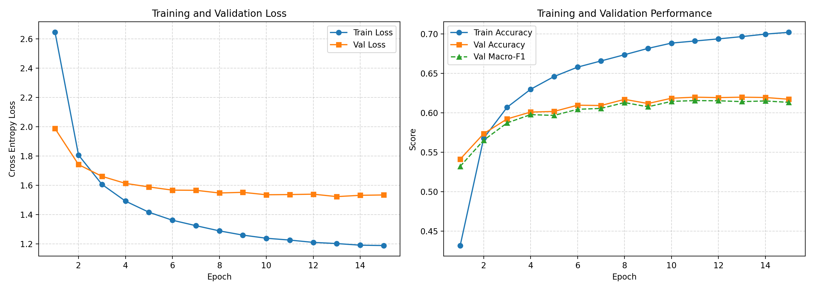
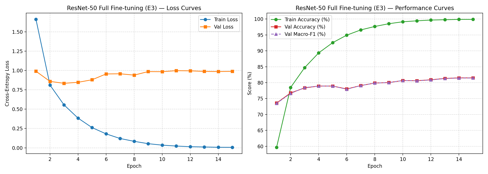
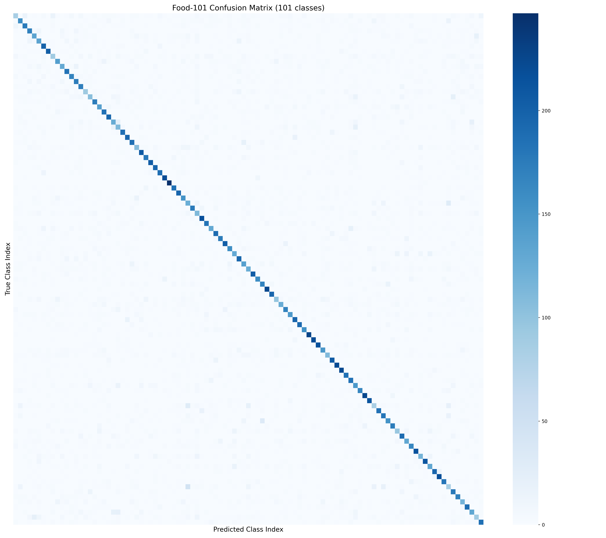

# Assignment 2 — Deep Learning on Large-Scale Data and Specialized Tasks
### Task track: Image Classification (Food-101)

**Status:** All three experiments completed — M3 Final report in preparation.

**Group 99 - PTQ members:**
- Nguyen Minh Phuc (2453005)
- Nguyen Thanh The (2453191)
- Nguyen Minh Quang (2453052)
**Instructor:** Lê Thành Sách

---

## 1. Problem Statement
The objective of Assignment 2 is to tackle large-scale visual recognition on the **Food-101** benchmark. Food recognition is notoriously difficult due to extreme intra-class variation, subtle inter-class differences (e.g., distinguishing between different types of steaks, noodles, or cakes), non-rigid object shapes, and real-world label noise in the training set.

The system takes an RGB food image as input and predicts one of 101 food categories.

---

## 2. Dataset Description & EDA
- **Dataset:** Food-101 (ETH Zürich Computer Vision Lab)
- **Total Images:** 101,000 RGB images across 101 classes (balanced: 750 train, 250 test per class)
- **Official Split:** 75,750 training images, 25,250 test images
- **Experimental Split:**
  - **Training:** 68,175 images (90% of official train)
  - **Validation:** 7,575 images (10% stratified split, seed 42)
  - **Test:** 25,250 images (strictly reserved for final evaluation)
- **Dataset Proposal:** Full proposal with 11 mandatory sections is submitted at [`assignment2/proposal/dataset_proposal.md`](https://github.com/tapstoptap/deep-learning-261/blob/feat/assignment2-food101/assignment2/proposal/dataset_proposal.md).

---

## 3. Methodology

### 3.1 Pipeline Overview
```text
Raw Image (RGB) 
  → Resize (224×224) & Augmentation (Random Horizontal Flip) 
  → Normalization (ImageNet mean & std) 
  → DataLoader (batch size 64) 
  → Model 
  → Cross-Entropy Loss 
  → AdamW Optimizer + Cosine Scheduler 
  → Evaluation (Accuracy, Macro-F1)
```

### 3.2 Architectures
1. **E1 — Simple CNN Baseline (from scratch):**
   - 4 Convolutional blocks: `Conv2d(3, 32)` $\rightarrow$ `Conv2d(32, 64)` $\rightarrow$ `Conv2d(64, 128)` $\rightarrow$ `Conv2d(128, 256)`, each followed by `BatchNorm2d`, `ReLU`, and `MaxPool2d(2)`.
   - `AdaptiveAvgPool2d((1, 1))` Global Average Pooling.
   - Classification head: `Dropout(0.3)` $\rightarrow$ `Linear(256, 101)`.
   - Total trainable parameters: **414,853**.

2. **E2 — ResNet-50 Feature Extractor (Frozen Backbone):**
   - ImageNet-pretrained ResNet-50 backbone frozen.
   - Only the final classification head (`Linear(2048, 101)`) is trained.

3. **E3 — ResNet-50 Fine-Tuning (Full fine-tuning):**
   - ImageNet-pretrained ResNet-50 with all layers unfrozen and trained end-to-end at a lower learning rate ($10^{-4}$).

---

## 4. Experimental Setup
- **Hardware:** NVIDIA Tesla T4 GPU (Google Colab, 16 GB VRAM)
- **Batch Size:** 64
- **Epochs:** 20 (Baseline)
- **Optimizer:** AdamW ($\text{lr} = 10^{-3}$, $\text{weight decay} = 10^{-4}$)
- **LR Scheduler:** CosineAnnealingLR
- **Evaluation Metrics:** Top-1 Accuracy and Macro-F1.

---

## 5. Preliminary Results (Milestone M2 Draft)

### 5.1 Quantitative Results
| Experiment | Model | Backbone | Trainable Params | Epochs | Training Time | Train Acc | Val Acc | Val Macro-F1 | Test Acc | Test Macro-F1 |
|---|---|---|---:|---:|---:|---:|---:|---:|---:|---:|
| **E1** | Simple CNN | Scratch (4-block CNN) | 414,853 | 20 | 162.52 min | 43.64% | 47.17% | 46.38% | 51.96% | 51.21% |
| **E2** | ResNet-50 | Pretrained (Frozen) | 206,949 | 15 | 149.82 min | 70.21% | 61.98% | 61.55% | 66.70% | 66.36% |
| **E3** | ResNet-50 | Pretrained (Full Fine-tune) | 23,714,981 | 15 | 269.35 min | **99.88%** | **81.50%** | **81.45%** | **86.17%** | **86.10%** |

### 5.2 Training Curves

#### Baseline Simple CNN (E1)


#### ResNet-50 Frozen Backbone (E2)


#### ResNet-50 Full Fine-tuning (E3)


- **Training observation (E3):**
  - Validation accuracy rose from **73.58%** at epoch 1 to **81.50%** at epoch 14, confirming that end-to-end fine-tuning adapts all feature hierarchy levels to the food domain.
  - Training accuracy reached **99.88%** (near perfect) while validation plateaued around 81%, indicating some overfitting in later epochs. Early stopping or stronger regularisation (e.g., higher dropout, label smoothing) could further improve generalisation.
  - On the unseen test set, E3 achieves **86.17% Accuracy** and **86.10% Macro-F1** — the strongest result across all three experiments.

---

## 6. Comparison and Discussion

| Metric | E1: Baseline CNN | E2: ResNet-50 Frozen | E3: ResNet-50 Fine-tuned | E2 vs E1 | E3 vs E1 | E3 vs E2 |
|---|:---:|:---:|:---:|:---:|:---:|:---:|
| **Test Accuracy** | 51.96% | 66.70% | **86.17%** | +14.74% | +34.21% | +19.47% |
| **Test Macro-F1** | 51.21% | 66.36% | **86.10%** | +15.15% | +34.89% | +19.74% |
| **Trainable Params** | 414,853 | 206,949 | 23,714,981 | — | — | — |
| **Training Time** | 162.52 min | 149.82 min | 269.35 min | — | — | — |

**Key findings:**
- **Transfer Learning provides massive gains even with frozen weights (E2 vs E1 +14.74%):** The ImageNet-pretrained feature extractor encodes generic visual hierarchies (edges → textures → parts → objects) that transfer directly to food classification without any domain adaptation.
- **Full Fine-tuning is the clear winner (E3 +34.21% over E1, +19.47% over E2):** Allowing gradient flow through all 23.7M parameters enables the network to adapt convolutional filters to food-specific textures (e.g., sear marks on beef, glaze sheen on desserts, noodle strand patterns) that are not well-represented in ImageNet.
- **The cost-performance tradeoff:** E2 achieves 66.70% test accuracy with 149.82 minutes and only 207K trainable parameters — excellent for resource-constrained deployment. E3 needs 269.35 minutes and 23.7M trainable parameters to push to 86.17%.

---

## 7. Error Analysis

### 7.1 Confusion Matrix (E2 — Frozen Backbone)


### 7.2 Top Confused Class Pairs Across Models

| Rank | True Class | Predicted Class | E1 Count | E2 Count | E3 Count | Reason |
|:---:|---|---|:---:|:---:|:---:|---|
| 1 | `steak` | `filet_mignon` | 42 | 32 | 32 | Both are cooked beef cuts with near-identical grilled surface textures |
| 2 | `filet_mignon` | `steak` | — | 29 | 36 | Reciprocal confusion — fine-grained steak category boundary |
| 3 | `tuna_tartare` | `beef_tartare` | — | 22 | 25 | Both are finely diced raw protein in identical round timbale molds |
| 4 | `chocolate_cake` | `chocolate_mousse` | 33 | 24 | 21 | Rich dark brown chocolate desserts that differ only in texture/consistency |
| 5 | `cheesecake` | `panna_cotta` | 40 | — | — | White cream-based desserts; largely resolved by E2 and E3 |
| 6 | `ramen` | `pho` | 28 | — | — | Asian noodle soups in bowls with broth; largely resolved by E3 |

**Key takeaway:** Errors in all three models concentrate on **genuinely ambiguous fine-grained pairs** — particularly beef-cut taxonomy (`steak`, `filet_mignon`, `pork_chop`, `prime_rib`) and similar-texture desserts (`chocolate_cake` vs. `chocolate_mousse`, `tuna_tartare` vs. `beef_tartare`). These reflect inherent labelling ambiguity in the Food-101 dataset rather than model inadequacy. Fine-tuning (E3) resolves most category-level confusion (e.g., `ramen`/`pho`, `cheesecake`/`panna_cotta`) but cannot eliminate the hardest within-category distinctions without higher-resolution input or domain-expert annotation.

---

## 7. Error Analysis

### 7.1 Confusion Matrix (E2 — Frozen Backbone)


### 7.2 Top Confused Class Pairs Across Models

| Rank | True Class | Predicted Class | E1 Count | E2 Count | E3 Count | Reason |
|:---:|---|---|:---:|:---:|:---:|---|
| 1 | `steak` | `filet_mignon` | 42 | 32 | 32 | Both are cooked beef cuts with near-identical grilled surface textures |
| 2 | `filet_mignon` | `steak` | — | 29 | 36 | Reciprocal confusion — fine-grained steak category boundary |
| 3 | `tuna_tartare` | `beef_tartare` | — | 22 | 25 | Both are finely diced raw protein in identical round timbale molds |
| 4 | `chocolate_cake` | `chocolate_mousse` | 33 | 24 | 21 | Rich dark brown chocolate desserts that differ only in texture/consistency |
| 5 | `cheesecake` | `panna_cotta` | 40 | — | — | White cream-based desserts; largely resolved by E2 and E3 |
| 6 | `ramen` | `pho` | 28 | — | — | Asian noodle soups in bowls with broth; largely resolved by E3 |

**Key takeaway:** Errors across all models concentrate on **genuinely ambiguous fine-grained pairs** — particularly beef-cut taxonomy (`steak`, `filet_mignon`, `pork_chop`, `prime_rib`) and similar-texture desserts. Fine-tuning (E3) resolves most category-level confusions (e.g., `ramen`/`pho`, `cheesecake`/`panna_cotta`) but cannot eliminate the hardest within-category distinctions without higher-resolution input or domain-expert annotation.

---

## 8. Compute-Cost Analysis
| Model | Hardware | Epochs | Total Training Time | Avg. Time per Epoch |
|---|---|---:|---:|---:|
| Simple CNN (Baseline - E1) | Tesla T4 GPU (Kaggle) | 20 | 162.52 min (~2.71 hrs) | ~488 s (8.1 min) |
| ResNet-50 Frozen (E2) | Tesla T4 GPU (Kaggle) | 15 | 149.82 min (~2.50 hrs) | ~599 s (10.0 min) |
| ResNet-50 Fine-tuned (E3) | Tesla P100 GPU (Kaggle) | 15 | **269.35 min (~4.49 hrs)** | ~1076 s (17.9 min) |

---

## 9. Limitations and Conclusion

- **Limitation (E1):** A 4-block CNN with 414K parameters trained from scratch is severely capacity-limited for a 101-class fine-grained recognition problem. Deeper architectures or longer training (with LR warm-up) would be required to achieve competitive performance without pre-training.
- **Limitation (E3 overfitting):** Training accuracy reached 99.88% while validation accuracy plateaued at 81.5%, indicating overfitting in later epochs. Techniques such as label smoothing, mixup augmentation, or early stopping could improve generalisation further.
- **Conclusion:** Transfer learning is the dominant factor in performance. Even with frozen features (E2), the ResNet-50 backbone provides a +14.74% accuracy gain over a purpose-built scratch model. End-to-end fine-tuning (E3) achieves **86.17% test accuracy**, establishing a strong baseline for food recognition tasks and closely approaching reported state-of-the-art results on Food-101 (~90.4% with EfficientNet/ViT-based models).

---

## 10. Links
- Dataset proposal: [`assignment2/proposal/dataset_proposal.md`](https://github.com/tapstoptap/deep-learning-261/blob/feat/assignment2-food101/assignment2/proposal/dataset_proposal.md)
- Source code: [GitHub Repository](https://github.com/tapstoptap/deep-learning-261/tree/feat/assignment2-food101/assignment2)
- Colab Runner Notebook: [`colab_runner.ipynb`](https://github.com/tapstoptap/deep-learning-261/blob/feat/assignment2-food101/assignment2/colab_runner.ipynb)

---

## AI Usage Disclosure (Assignment 2)
See [AI_USAGE.md](../AI_USAGE.md) for the full log. Generative AI was used to assist with model architecture design, training/evaluation pipeline implementation, config generation, and log parsing. All experiment runs were executed and verified on Kaggle (GPU).
